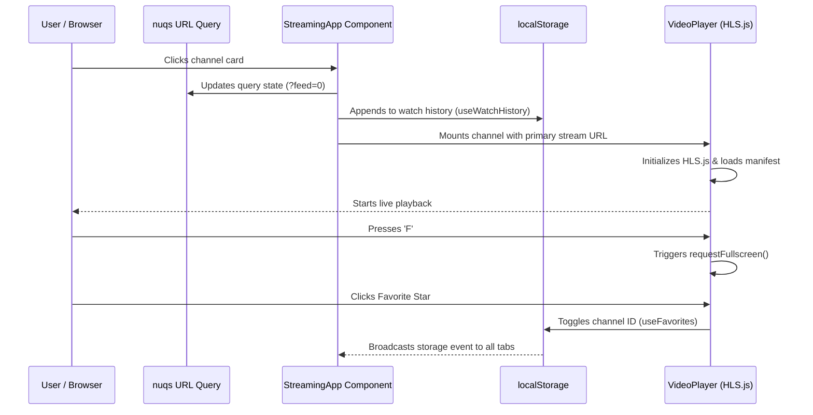

# 📐 PulseTV — Project Architecture & Structural Breakdown

This document provides a technical dive into the directory layout, module relationships, component hierarchy, and data pipelines of the **PulseTV** codebase.

---

## 🏗 High-Level Architecture Overview

PulseTV is built upon the **Next.js 16 App Router** paired with **React 19** and **Tailwind CSS v4**. It leverages Server Components for pre-fetching data and Client Components for low-latency player controls and reactive state.

```mermaid
graph TD
    subgraph Routing ["App Routing (src/app)"]
        Layout["Root Layout (layout.tsx)\n[Geist Font, ThemeProvider, NuqsAdapter]"]
        Page["Home Page (page.tsx)\n[Server-side data prefetch]"]
        WatchPage["Watch Route (watch/[id]/page.tsx)\n[Dynamic channel resolver & SEO]"]
    end

    subgraph CoreServices ["Core Services (src/lib)"]
        IPTVService["iptv-service.ts\n[iptv-org API, In-memory Caching, Filtering]"]
        IPTVMateService["iptvmate-service.ts\n[M3U Parser & Fallback Feeds]"]
        AdultChannels["adult-channels.ts\n[Curated Adult Channel Feeds]"]
    end

    subgraph ClientComponents ["Client Layer (src/components)"]
        StreamingApp["StreamingApp (streaming-app.tsx)\n[Master client orchestrator & nuqs query state]"]
        Header["Header (layout/header.tsx)\n[Navigation, Search, Favorites badge, Theme]"]
        Hero["HeroSection (home/hero-section.tsx)\n[Spotlight live banner]"]
        CategoryBar["CategoryBar (channels/category-bar.tsx)\n[Genre pills]"]
        FilterToolbar["FilterToolbar (channels/filter-toolbar.tsx)\n[Country filter, view mode, logo filter]"]
        VideoPlayer["VideoPlayer (player/video-player.tsx)\n[Hls.js, controls, theater, PiP, feeds]"]
        AdultSection["AdultSection (adult/adult-section.tsx)"]
        IptvMateSection["IptvMateSection (iptvmate/iptvmate-section.tsx)"]
    end

    subgraph StateStores ["State Management (src/hooks)"]
        FavHook["useFavorites (use-favorites.ts)\n[useSyncExternalStore + localStorage]"]
        HistHook["useWatchHistory (use-watch-history.ts)\n[useSyncExternalStore + localStorage]"]
        NuqsState["URL Query State (nuqs)\n[tab, q, category, country, feed, theater]"]
    end

    Layout --> Page
    Layout --> WatchPage
    Page --> IPTVService
    WatchPage --> IPTVService
    IPTVService --> IPTVMateService
    IPTVService --> AdultChannels

    Page --> StreamingApp
    StreamingApp --> Header
    StreamingApp --> Hero
    StreamingApp --> CategoryBar
    StreamingApp --> FilterToolbar
    StreamingApp --> VideoPlayer
    StreamingApp --> AdultSection
    StreamingApp --> IptvMateSection

    StreamingApp <--> NuqsState
    StreamingApp <--> FavHook
    StreamingApp <--> HistHook
    WatchPage --> VideoPlayer
```



---

## 📂 Deep Directory & File Breakdown

### 1. `src/app/` — Next.js App Router

Contains application routes, server entry points, and REST API route handlers.

```
src/app/
├── api/
│   ├── categories/route.ts   # Dynamic category counts & list
│   ├── channel/[id]/route.ts # Channel details & stream URLs by channel ID
│   ├── channels/route.ts     # Channel search, pagination, and multi-filter API
│   ├── countries/route.ts    # List of broadcasting countries with flag emojis
│   ├── featured/route.ts     # Spotlight hero channel & top channels by genre
│   └── iptvmate/route.ts     # IPTVMate M3U playlist scraper & feed parser
├── watch/[id]/
│   └── page.tsx              # Standalone cinema watch page for a specific channel
├── favicon.ico               # Public browser favicon
├── globals.css               # Tailwind CSS v4 setup and theme design tokens
├── layout.tsx                # Global HTML wrapper (Fonts, ThemeProvider, NuqsAdapter)
└── page.tsx                  # Home route (Server Component with Promise.all data fetch)
```

- **`layout.tsx`**: Sets up Geist Sans and Mono fonts, configures `next-themes` dark mode default, and attaches `NuqsAdapter` for App Router URL state synchronization.
- **`page.tsx`**: Executes a parallel `Promise.all` on the server to prefetch featured channels, active countries, initial page of channels, and popular categories, minimizing client layout shifts.
- **`watch/[id]/page.tsx`**: Uses dynamic route parameter `[id]` to resolve channel streams, generates dynamic OpenGraph and Twitter card metadata for SEO, fetches related category streams, and renders `WatchChannelView`.

---

### 2. `src/components/` — UI Components & Views

Organized modularly by domain feature:

#### A. `player/` (Video Playback Engine)
- **`video-player.tsx`**:
  - HLS engine built on `hls.js`.
  - Fallback logic for native WebKit HLS (`video.canPlayType('application/vnd.apple.mpegurl')`).
  - Feed switcher dropdown allowing users to change audio/video feeds.
  - Theater mode toggle, fullscreen toggle, Picture-in-Picture trigger.
  - Keyboard shortcut listeners (`Space`, `k`, `m`, `f`, `t`, `p`, `r`, arrows).
  - External player launcher button (`vlc://` / copy stream URL).
  - Stream retry mechanism and error reporting card.
- **`watch-channel-view.tsx`**:
  - Cinema layout for `/watch/:id`.
  - Renders the video player at the top, followed by channel meta tags, website link, share sheet, and a grid of related category channels.
  - Preserves back-navigation destination (remembers search query, filters, and page index from previous browse session).

#### B. `channels/` (Channel Discovery & Cards)
- **`channel-card.tsx`**: Interactive card with country flag, HD quality badge, active stream indicator, logo fallback with channel initials, and favorite toggle.
- **`channel-list-item.tsx`**: Compact horizontal table-like view for data-dense channel browsing.
- **`category-bar.tsx`**: Horizontal scrollable pill bar listing popular categories with channel counts.
- **`filter-toolbar.tsx`**: Country dropdown selector, "With Logos Only" checkbox, and Grid/List view toggle.
- **`channel-modal.tsx`**: Quick preview modal displaying stream metadata, broadcaster networks, launch date, and alternative stream feeds.

#### C. `home/` (Dashboard Views)
- **`hero-section.tsx`**: Spotlight banner featuring a high-definition live channel with live ping badge, background ambient glows, direct Play button, and channel info modal trigger.
- **`channel-row.tsx`**: Horizontal carousel featuring scroll buttons and category channel cards.

#### D. `adult/` & `iptvmate/` (Specialty Live Hubs)
- **`adult-section.tsx`**: Dedicated adult entertainment portal with 18+ warning header, genre filtering (`Live Cams`, `MILF`, `Latina`, `Asian`, `POV`, etc.), and search.
- **`iptvmate-section.tsx`**: Aggregates live feeds parsed from `iptvmate.net/files/xxx.m3u` with provider filters (`MyCamTV`, `IPTVXXX`) and subgenre tags.

#### E. `layout/` & `ui/` (Shared Layout & Primitives)
- **`layout/header.tsx`**: Global fixed navigation bar containing logo, quick search bar, navigation tab pills (`Discover`, `Browse`, `IPTVMate`, `Adult`, `Favorites`), and the theme toggle.
- **`mode-toggle.tsx`**: Sun/Moon toggle button utilizing `next-themes`.
- **`ui/`**: Base UI primitives (`button.tsx`, `badge.tsx`, `dialog.tsx`, `dropdown-menu.tsx`, `input.tsx`).

---

### 3. `src/hooks/` — Reactive Persistence Layer

- **`use-favorites.ts`**:
  - Implements React 19's `useSyncExternalStore` pattern.
  - Manages favorite channel IDs in `localStorage` under key `pulsetv_favorites_v1`.
  - Subscribes to window `storage` events to ensure cross-tab synchronization.
- **`use-watch-history.ts`**:
  - Manages the last 12 played channels in `localStorage` under key `pulsetv_watch_history_v1`.
  - Automatically deduplicates and shifts recent channels to the front of the list.

---

### 4. `src/lib/` — Backend Business Logic & Data Services

- **`iptv-service.ts`**:
  - Fetches `channels.json`, `streams.json`, `logos.json`, `categories.json`, `countries.json`, and `languages.json` from `https://iptv-org.github.io/api/`.
  - Maintains an in-memory 6-hour cache (`cache: CachedData | null`).
  - Implements fast O(1) hash maps: `streamMap`, `logoMap`, `countryMap`, `categoryMap`.
  - Enriches channels by combining stream URLs, quality markers, broadcast logos, and country information.
  - Prioritizes streams using the ranking formula: stream presence $\to$ logo presence $\to$ resolution ($1080\text{p} > 720\text{p} > 480\text{p}$) $\to$ title.
  - Implements `searchChannels()`, `getChannelById()`, `getPopularCategories()`, `getAvailableCountries()`, and `getFeaturedChannels()`.
- **`iptvmate-service.ts`**:
  - Fetches M3U playlists from `https://iptvmate.net/files/xxx.m3u`.
  - Parses `#EXTINF` metadata into normalized `EnrichedChannel` objects.
  - Houses a fallback channel catalog (`FALLBACK_RAW_ENTRIES`) ensuring zero downtime even if the external M3U file is unreachable.
- **`adult-channels.ts`**:
  - Curated fallback list of specialty channels with validated HLS stream URLs.
- **`utils.ts`**:
  - Helper function `cn()` combining `clsx` and `twMerge` for conditional Tailwind CSS classes.

---

### 5. `src/types/` — Data Models

- **`IPTVChannel`**: Raw metadata from `iptv-org` (id, name, alt_names, network, country, categories, is_nsfw, website).
- **`IPTVStream`**: Stream metadata (channel, feed, title, url, quality, labels, user_agent, referrer).
- **`IPTVLogo`**: Logo asset details (channel, in_use, width, height, format, url).
- **`IPTVCountry`**: Country details (name, code, languages, flag emoji).
- **`IPTVCategory`**: Category definition (id, name, description).
- **`EnrichedChannel`**: Comprehensive composite channel model containing resolved `streamUrl`, `streams[]`, `quality`, `logo`, `countryName`, and `countryFlag`.

---

## 🔄 State Flow & Synchronization



---

## 🛠 Configuration Reference

- **`next.config.ts`**:
  - React Compiler enabled (`reactCompiler: true`).
  - Turbopack CSS loader integration (`@tailwindcss/turbopack`).
  - Experimental features: `agentFeedback: true`.
- **`tsconfig.json`**:
  - Strict TypeScript configuration with `@/*` path alias mapped to `./src/*`.
- **`eslint.config.mjs`**:
  - Next.js 16 core web vitals and TypeScript ESLint rules.
