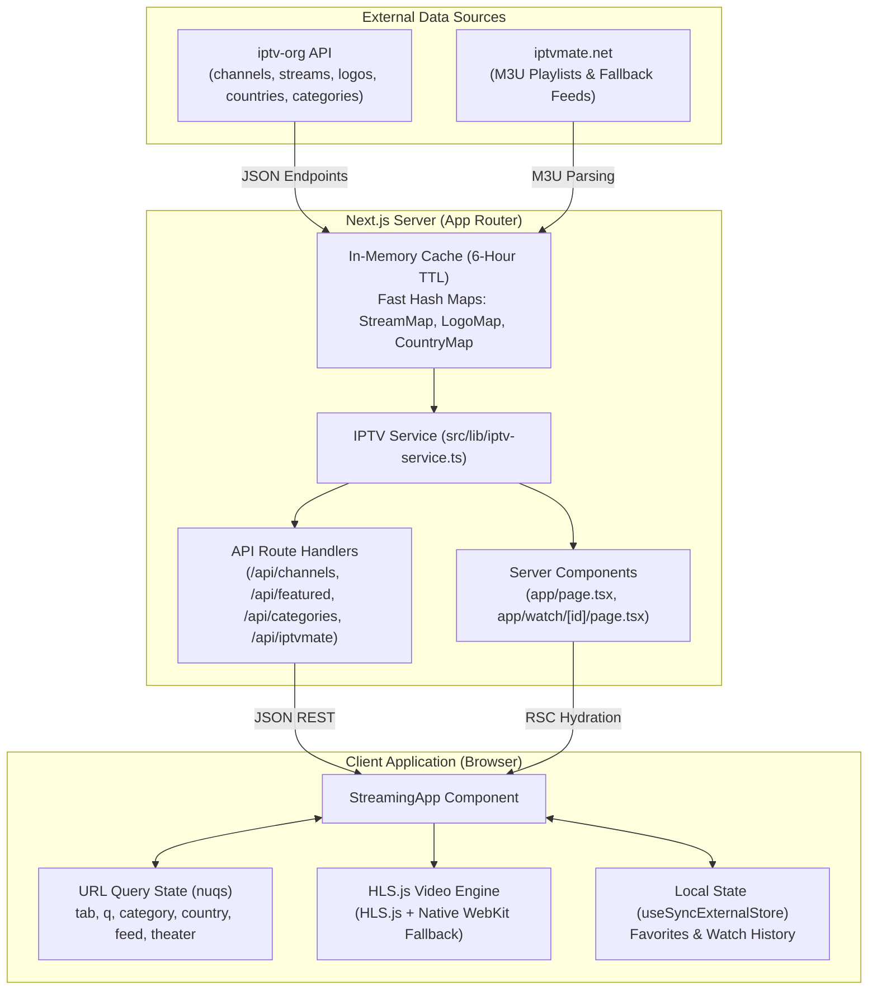

# 📺 PulseTV — Free Global Live Television & Streaming Platform

[](https://nextjs.org/)
[](https://react.dev/)
[](https://www.typescriptlang.org/)
[](https://tailwindcss.com/)
[](https://github.com/video-dev/hls.js/)
[](https://turbo.build/pack)
[](LICENSE)

**PulseTV** is a high-performance, modern web application for streaming over 10,000+ free, legal, and publicly accessible live television channels from around the world. Built with **Next.js 16 (App Router)**, **React 19**, **Tailwind CSS v4**, and **HLS.js**, PulseTV delivers a cable-like streaming experience with instant channel switching, deep category exploration, multi-feed selection, cinema watch mode, persistent favorites, and watch history.

---

## 📑 Table of Contents

- [Overview](#-overview)
- [Project Architecture & Deep Dive (PROJECT_STRUCTURE.md)](PROJECT_STRUCTURE.md)
- [Key Features](#-key-features)
  - [1. Video Player & Playback](#1-video-player--playback)
  - [2. Discovery & Navigation](#2-discovery--navigation)
  - [3. Specialty Hubs](#3-specialty-hubs)
  - [4. State Persistence & Synchronization](#4-state-persistence--synchronization)
  - [5. UI & Responsive Design](#5-ui--responsive-design)
- [Architecture & Data Pipeline](#-architecture--data-pipeline)
  - [System Flow](#system-flow)
  - [Data Ingestion & In-Memory Indexing](#data-ingestion--in-memory-indexing)
  - [Channel Quality & Scoring Algorithm](#channel-quality--scoring-algorithm)
- [Project Structure](#-project-structure)
  - [Directory Tree](#directory-tree)
  - [Key Directories & Files Explained](#key-directories--files-explained)
- [Setup & Installation Guide](#-setup--installation-guide)
  - [Prerequisites](#prerequisites)
  - [Installation Steps](#installation-steps)
  - [Available Scripts](#available-scripts)
  - [Environment Configuration](#environment-configuration)
- [REST API Documentation](#-rest-api-documentation)
- [Keyboard Shortcuts](#-keyboard-shortcuts)
- [Troubleshooting & FAQs](#-troubleshooting--faqs)
- [License & Disclaimer](#-license--disclaimer)

---

## 🌟 Overview

PulseTV aggregates public streaming data from the global [iptv-org](https://github.com/iptv-org/iptv) database and parsed M3U playlists from [iptvmate.net](https://iptvmate.net). It provides an in-memory caching engine that correlates live stream endpoints, broadcast logos, country identifiers, and genres to produce an ultra-fast, searchable television directory.

### Why PulseTV?
- **Zero Registration**: Open and start watching live news, sports, entertainment, and movies immediately.
- **Ultra-Fast Search**: Instant search and country/category filtering backed by server-side indexing and URL state synchronization.
- **Modern Media Controls**: Supports multi-feed switching, cinema theater mode, native Picture-in-Picture (PiP), external player launching (VLC, MPV, IINA), and comprehensive keyboard shortcuts.
- **Resilient Fallback**: Gracefully handles offline streams, fallback poster rendering, and broken feed reporting.

---

## ⚡ Key Features

### 1. Video Player & Playback
- **Adaptive Bitrate HLS Streaming**: Powered by `hls.js` with automatic native HLS fallback for Safari and iOS WebKit.
- **Multi-Feed Switcher**: Channels with multiple broadcast feeds (alternate audio tracks, regional feeds, different resolutions) can be switched directly from the player interface.
- **Cinema Theater & Fullscreen Modes**: Expand to a full-width theater layout or native full-screen viewing.
- **Picture-in-Picture (PiP)**: Keep streams playing in a floating desktop window while browsing other channels or apps.
- **External Player Hand-off**: Copy raw `.m3u8` stream URLs with a single click or open streams directly in external media players such as VLC, MPV, IINA, or PotPlayer.
- **Live Stream Indicator**: Pulsing status badge and real-time buffer state indication.
- **Keyboard Shortcuts**: Complete hotkey support for play/pause, volume adjustment, mute, fullscreen, theater mode, and stream reload.

### 2. Discovery & Navigation
- **Hero Spotlight**: Dynamic showcase banner highlighting a featured high-definition live channel.
- **Curated Category Carousels**: Dedicated horizontal scrolling rows for popular categories including **News**, **Sports**, **Movies**, **Music**, and **Animation**.
- **Bi-Directional URL State Sync**: Uses `nuqs` to synchronize tabs, search terms, categories, countries, view modes, and player states directly into the browser URL for easy bookmarking and sharing.
- **Country Filter**: Filter channels from over 150+ countries with national flags, localized channel counts, and prioritized sorting for top broadcasting nations.
- **Grid & List Display Modes**: Switch between rich visual card grids and compact, data-dense channel lists.
- **Quick Preview Modal**: View detailed channel metadata, broadcast owner, launch year, official website, and alternative stream feeds without navigating away.

### 3. Specialty Hubs
- **Discover Tab**: High-level curated dashboard featuring the spotlight hero and top category carousels.
- **Browse Tab**: Complete channel catalog with pagination, logo filtering, text search, and country selectors.
- **IPTVMate Tab**: Dedicated section aggregating live interactive webcams and streams parsed from `iptvmate.net/files/xxx.m3u` with provider filters (`MyCamTV`, `IPTVXXX`) and genre tags.
- **Adult / NSFW Tab (18+)**: Specialty adult channel directory featuring category filtering, live cam feeds, and adult entertainment broadcasts with an explicit content disclaimer.
- **Favorites Tab**: Dedicated dashboard for bookmarked channels with quick play access.

### 4. State Persistence & Synchronization
- **External Store Sync**: Employs React 19's `useSyncExternalStore` for seamless synchronization between local browser storage (`localStorage`) and React components.
- **Cross-Tab Synchronization**: Changes to favorites or watch history in one browser tab automatically update all open tabs via native `storage` events.
- **Watch History**: Automatically tracks the last 12 channels played with one-click clear and direct replay.

### 5. UI & Responsive Design
- **Tailwind CSS v4**: Built with the next-generation Tailwind engine and Turbopack compiler.
- **Dark Mode by Default**: Immersive, high-contrast dark aesthetic tailored for video streaming with optional light mode via `next-themes`.
- **Responsive Layout**: Fully optimized across desktop monitors, tablets, and mobile devices.

---

## 🏗 Architecture & Data Pipeline

### System Flow



### Data Ingestion & In-Memory Indexing
To prevent thousands of slow redundant API requests, `src/lib/iptv-service.ts` fetches datasets from `https://iptv-org.github.io/api/` once and stores them in an in-memory cache with a 6-hour TTL (`CACHE_TTL_MS = 21,600,000 ms`).

The service generates `O(1)` lookup tables:
- `streamMap`: Maps `channel_id` $\to$ Array of `IPTVStream` records.
- `logoMap`: Maps `channel_id` $\to$ High-resolution logo URL.
- `countryMap`: Maps country ISO code $\to$ `IPTVCountry` (name, flag, language codes).
- `categoryMap`: Maps category slug $\to$ `IPTVCategory` metadata.

### Channel Quality & Scoring Algorithm
Channels are scored and ordered using a multi-factor sorting pipeline:
1. **Stream Availability**: Channels with verified working stream URLs are placed first.
2. **Branding Assets**: Channels with verified logos take precedence over text-only entries.
3. **Stream Resolution**: Higher quality streams are prioritized ($4\text{K} / 1080\text{p} > 720\text{p} > 480\text{p}$).
4. **Alphabetical Tie-breaker**: Sorted by clean channel title.

---

## 📁 Project Structure

### Directory Tree

```
iptv/
├── .vscode/                     # VS Code editor settings
├── public/                      # Static assets & public icons
│   ├── images/                  # Channel & provider SVG logos
│   │   ├── adultiptv.svg        # Adult section branding icon
│   │   ├── iptvmate.svg         # IPTVMate provider logo
│   │   ├── iptvxxx.svg          # IPTVXXX provider logo
│   │   └── mycamtv.svg          # MyCamTV provider logo
│   ├── favicon.ico              # Browser favicon
│   ├── globe.svg                # Public asset icon
│   ├── next.svg                 # Next.js logo
│   └── vercel.svg               # Vercel deployment badge
├── src/                         # Application source code
│   ├── app/                     # Next.js App Router
│   │   ├── api/                 # Backend Route Handlers (REST endpoints)
│   │   │   ├── categories/      # GET /api/categories
│   │   │   │   └── route.ts     # Returns active categories with channel counts
│   │   │   ├── channel/         # GET /api/channel/[id]
│   │   │   │   └── [id]/        # Channel ID dynamic route
│   │   │   │       └── route.ts # Returns enriched channel by ID
│   │   │   ├── channels/        # GET /api/channels
│   │   │   │   └── route.ts     # Search, filter, and paginate channels
│   │   │   ├── countries/       # GET /api/countries
│   │   │   │   └── route.ts     # Returns countries with flags & channel counts
│   │   │   ├── featured/        # GET /api/featured
│   │   │   │   └── route.ts     # Returns spotlight hero and category channels
│   │   │   └── iptvmate/        # GET /api/iptvmate
│   │   │       └── route.ts     # IPTVMate M3U playlist scraper & feed parser
│   │   ├── watch/               # Dedicated Watch Route
│   │   │   └── [id]/            # Channel ID dynamic page
│   │   │       └── page.tsx     # Cinema watch page with related channels
│   │   ├── favicon.ico          # App icon
│   │   ├── globals.css          # Tailwind CSS v4 directives & color variables
│   │   ├── layout.tsx           # Root HTML layout with Geist font & NuqsAdapter
│   │   └── page.tsx             # Root page (Server Component prefetching data)
│   ├── components/              # UI & Feature components
│   │   ├── adult/               # Adult / NSFW Section components
│   │   │   └── adult-section.tsx # Adult hub grid, search, and genre tags
│   │   ├── channels/            # Channel display & discovery components
│   │   │   ├── category-bar.tsx # Horizontal scrolling category navigation pill bar
│   │   │   ├── channel-card.tsx # Rich channel card with logo, flag, and badges
│   │   │   ├── channel-list-item.tsx # Compact list row view
│   │   │   ├── channel-modal.tsx# Channel preview modal with stream inspection
│   │   │   └── filter-toolbar.tsx # Country selector, logo filter, view toggle
│   │   ├── home/                # Home dashboard components
│   │   │   ├── channel-row.tsx  # Horizontal channel carousel with scroll controls
│   │   │   └── hero-section.tsx # Spotlight hero banner with play & info actions
│   │   ├── iptvmate/            # IPTVMate components
│   │   │   └── iptvmate-section.tsx # Live cam feeds, provider filter & player
│   │   ├── layout/              # Structural layout components
│   │   │   └── header.tsx       # Top navigation bar, search input, tabs & theme toggle
│   │   ├── player/              # Video playback components
│   │   │   ├── video-player.tsx # HLS.js video player with full custom controls
│   │   │   └── watch-channel-view.tsx # Cinema layout with player & related feed
│   │   ├── ui/                  # Reusable UI primitives
│   │   │   ├── badge.tsx        # Styled badge primitive
│   │   │   ├── button.tsx       # Button variants (default, outline, ghost, rose)
│   │   │   ├── dialog.tsx       # Modal dialog container
│   │   │   ├── dropdown-menu.tsx# Base UI dropdown menu component
│   │   │   └── input.tsx        # Styled input element
│   │   ├── mode-toggle.tsx      # Dark / Light theme switch button
│   │   ├── streaming-app.tsx    # Master client orchestrator component
│   │   └── theme-provider.tsx   # next-themes ThemeProvider wrapper
│   ├── hooks/                   # Custom React hooks
│   │   ├── use-favorites.ts     # Persistent favorites hook (useSyncExternalStore)
│   │   └── use-watch-history.ts # Persistent watch history hook (useSyncExternalStore)
│   ├── lib/                     # Business logic and utility libraries
│   │   ├── adult-channels.ts    # Curated fallback list of specialty adult channels
│   │   ├── iptv-service.ts      # Core IPTV ingestion, indexing & search service
│   │   ├── iptvmate-service.ts  # IPTVMate M3U playlist parser and fetcher
│   │   └── utils.ts             # Tailwind class merging utility (cn)
│   └── types/                   # TypeScript type declarations
│       └── iptv.ts              # Core types: IPTVChannel, IPTVStream, EnrichedChannel
├── .gitignore                   # Git ignore patterns
├── AGENTS.md                    # Next.js agent development guidelines
├── components.json              # Shadcn component configuration
├── eslint.config.mjs            # ESLint flat configuration
├── next-env.d.ts                # Next.js TypeScript ambient types
├── next.config.ts               # Next.js configuration (Turbopack, Compiler)
├── package.json                 # Project dependencies & npm scripts
├── package-lock.json            # Deterministic dependency lockfile
├── README.md                    # Project documentation
└── tsconfig.json                # TypeScript compiler configuration
```

### Key Directories & Files Explained

| Directory / File | Role & Responsibility |
| :--- | :--- |
| `src/app/page.tsx` | Root server component. Prefetches featured channels, countries, initial page, and categories in parallel (`Promise.all`), passing them into `StreamingApp`. |
| `src/app/watch/[id]/page.tsx` | Dynamic watch route (`/watch/:id`). Resolves channel by ID, computes dynamic SEO metadata, loads related channels from the same category, and displays `WatchChannelView`. |
| `src/lib/iptv-service.ts` | The core data engine. Fetches raw data from `iptv-org`, caches it for 6 hours, builds lookup maps, enriches channel records with logos and stream URLs, and provides search and filtering logic. |
| `src/lib/iptvmate-service.ts` | Dynamically downloads and parses `https://iptvmate.net/files/xxx.m3u`. Converts `#EXTINF` metadata into normalized `EnrichedChannel` records with fallback channel lists. |
| `src/components/streaming-app.tsx` | The central state hub. Manages `nuqs` URL query parameters, controls tab switching (`discover`, `browse`, `iptvmate`, `xxx`, `favorites`), and manages modals and playback state. |
| `src/components/player/video-player.tsx` | Custom video player built on `hls.js`. Implements stream switcher, playback controls, keyboard shortcuts, theater mode, and external player launching. |
| `src/hooks/use-favorites.ts` | Reactive favorites store using `useSyncExternalStore`. Syncs with `localStorage` and listens for `storage` events across browser tabs. |
| `src/hooks/use-watch-history.ts` | Reactive watch history store tracking the last 12 channels played. |

---

## 🚀 Setup & Installation Guide

### Prerequisites

Ensure you have the following installed on your machine:
- **Node.js**: `v20.0.0` or higher (LTS recommended)
- **Package Manager**: `npm`, `pnpm`, `yarn`, or `bun`
- **Modern Web Browser**: Chrome, Firefox, Edge, Safari, or Brave (supporting HLS or MediaSource Extensions)

### Installation Steps

1. **Clone the repository**:
   ```bash
   git clone https://github.com/your-username/iptv.git
   cd iptv
   ```

2. **Install project dependencies**:
   ```bash
   npm install
   # or
   pnpm install
   # or
   yarn install
   ```

3. **Start the development server with Turbopack**:
   ```bash
   npm run dev
   ```

4. **Open in your browser**:
   Navigate to [http://localhost:3000](http://localhost:3000). The development server will auto-reload when files are edited.

5. **Build for Production**:
   ```bash
   npm run build
   ```

6. **Start the Production Server**:
   ```bash
   npm run start
   ```

### Available Scripts

| Script | Command | Description |
| :--- | :--- | :--- |
| `npm run dev` | `next dev` | Launches the Next.js development server with Turbopack. |
| `npm run build` | `next build` | Compiles and optimizes the application for production deployment. |
| `npm run start` | `next start` | Runs the compiled production server on port 3000. |
| `npm run lint` | `eslint` | Analyzes code quality and style using ESLint. |

### Environment Configuration
PulseTV does not require any mandatory third-party API keys to run out-of-the-box. It accesses public data directly from `iptv-org` and `iptvmate.net`.

If running behind a custom proxy or configuring a custom port:
```bash
# Run on a custom port
npm run dev -- -p 4000
```

---

## 📡 REST API Documentation

PulseTV includes built-in Next.js App Router API route handlers for programmatic data access:

### 1. `GET /api/channels`
Searches, filters, and paginates channels.

**Query Parameters:**
- `query` *(string, optional)*: Search term to match channel name, network, or country.
- `category` *(string, optional)*: Category slug (e.g. `news`, `sports`, `movies`, `all`). Default: `all`.
- `country` *(string, optional)*: Two-letter ISO country code (e.g. `US`, `GB`, `IN`, `all`). Default: `all`.
- `nsfw` *(boolean, optional)*: Include or exclude adult/NSFW channels (`true` or `false`).
- `hasLogoOnly` *(boolean, optional)*: Restrict results to channels with verified logos.
- `page` *(number, optional)*: Page number. Default: `1`.
- `limit` *(number, optional)*: Results per page. Default: `24`.

**Example Request:**
```http
GET /api/channels?category=news&country=US&page=1&limit=10
```

---

### 2. `GET /api/channel/[id]`
Retrieves full metadata and all stream feeds for a single channel.

**Example Request:**
```http
GET /api/channel/cnn-us
```

---

### 3. `GET /api/featured`
Returns spotlight hero channel and top category channels (News, Sports, Movies, Music, Animation, XXX, IPTVMate).

**Example Request:**
```http
GET /api/featured
```

---

### 4. `GET /api/categories`
Returns all available channel categories with live channel counts, sorted by popularity.

**Example Request:**
```http
GET /api/categories
```

---

### 5. `GET /api/countries`
Returns all available broadcasting countries with ISO codes, flags, and channel counts.

**Example Request:**
```http
GET /api/countries
```

---

### 6. `GET /api/iptvmate`
Fetches and parses live feeds from IPTVMate M3U sources.

**Query Parameters:**
- `refresh` *(boolean, optional)*: Force cache refresh (`true` or `false`).
- `provider` *(string, optional)*: Filter by provider (e.g. `MyCamTV`, `IPTVXXX`, `all`).
- `tag` *(string, optional)*: Genre or category tag filter.
- `query` *(string, optional)*: Text search.

**Example Request:**
```http
GET /api/iptvmate?provider=MyCamTV&tag=live
```

---

## ⌨ Keyboard Shortcuts

When the video player is focused or active, the following hotkeys are available:

| Key | Action |
| :--- | :--- |
| <kbd>Space</kbd> or <kbd>K</kbd> | Toggle Play / Pause |
| <kbd>M</kbd> | Toggle Audio Mute / Unmute |
| <kbd>F</kbd> | Toggle Fullscreen Mode |
| <kbd>T</kbd> | Toggle Cinema Theater Mode |
| <kbd>P</kbd> | Toggle Picture-in-Picture (PiP) |
| <kbd>R</kbd> | Reload Current Stream Feed |
| <kbd>↑</kbd> | Increase Volume (+10%) |
| <kbd>↓</kbd> | Decrease Volume (-10%) |
| <kbd>Esc</kbd> | Exit Fullscreen / Close Modal |

---

## ❓ Troubleshooting & FAQs

### Common Issues

#### 1. Why do some channels show "Stream Offline or Blocked"?
Many IPTV streams are hosted on diverse third-party servers. Streams may fail or appear offline due to:
- **CORS Restrictions**: Some broadcasters do not allow web browsers to fetch their `.m3u8` playlists directly via JavaScript (`Access-Control-Allow-Origin`).
- **Geo-Blocking**: Certain national broadcasters restrict playback to viewers within their home country.
- **Temporary Downtime**: The broadcast feed might be temporarily inactive or experiencing network outages.
- **Mixed Content**: Loading HTTP streams on an HTTPS deployment can be blocked by browser security policies.

**Workaround**: Click the **"External Player"** button on the video player toolbar to copy the stream URL and open it directly in [VLC Media Player](https://www.videolan.org/vlc/) or [MPV](https://mpv.io/), which bypass browser CORS constraints.

#### 2. How can I switch to a different stream feed?
If a channel offers multiple stream sources, click the **"Feeds"** icon in the player controls to switch between alternate feeds, audio tracks, or backup servers.

#### 3. How do I clear my watch history or favorites?
- **Favorites**: Click the star icon on any channel card or in the player to toggle favorites.
- **Watch History**: Click the "Clear History" button located on the watch history carousel on the home screen.

---

## ⚖ License & Disclaimer

### Disclaimer
PulseTV is an open-source web application designed for browsing publicly available live streams. 
- PulseTV **does not host, store, or broadcast any video or media content** on its own servers.
- All channel listings, metadata, and stream URLs are indexed from third-party public repositories (such as [iptv-org](https://github.com/iptv-org/iptv) and publicly shared M3U playlists).
- The developers of PulseTV assume no liability for the content, availability, or legality of any linked third-party streams. Stream availability is governed by the respective broadcast owners.

### License
This project is open-source and released under the [MIT License](LICENSE).
